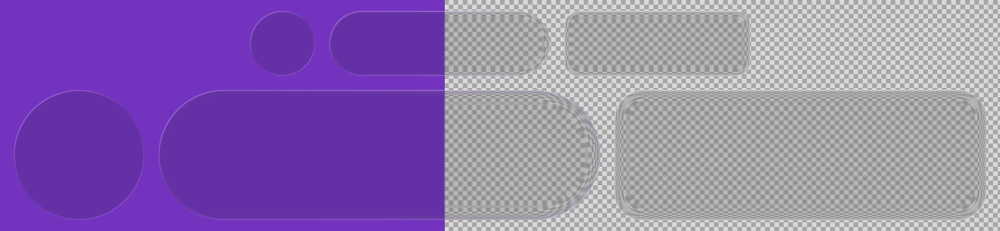
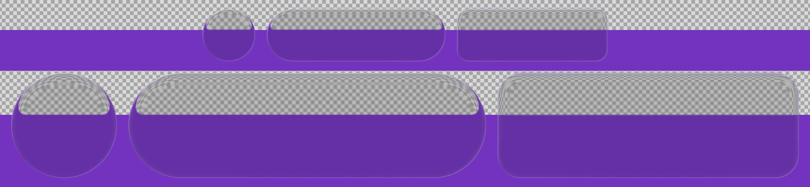
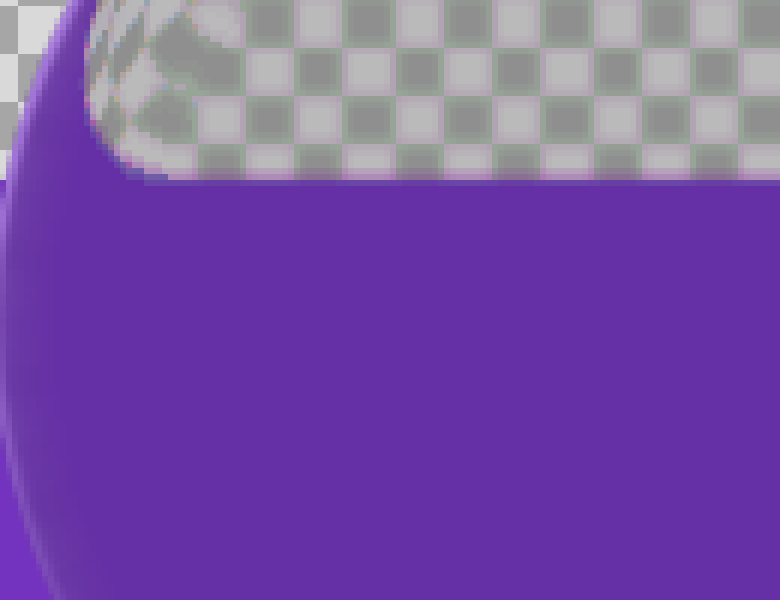

# correct-liquid-glass

A physically-inspired, iOS-style **liquid glass** refraction shader in HLSL, plus a Windows demo that applies it to your live desktop through Windows.Graphics.Capture.

Screenshots below use a synthetic test pattern (checkerboard + purple area), never a real desktop.




Rim close-up: the purple that touches the rim is carried along the contour (light pipe), and the lens mirrors the colour into the top bevel.



## What makes it "correct"

- **Thin bevel acting as a thick lens.** Only the outer quarter of the half-height bends, but at the very rim the sample point jumps up to 0.45 of the shape height inward, past the centre. Content deep inside shows up mirrored on the rim, like real thick glass.
- **Light-pipe rim.** The bevel carries the colour found just outside the edge, averaged along the contour, so a colour touching one part of the rim flows around the rest of it.
- **Flat centre with a slight opposite bend.** The middle stays calm and reads as glass, with a faint inverse magnification.
- **Bends measured from the corner-shrunk inner rectangle.** The extra bends are relative to the shape shrunk by its corner radius (a point for a circle, a segment for a pill, a real rectangle for a rounded rect). Straight edges stay flat and only corners bend.
- **Smooth-union groups for droplet morphs** (`shaders/liquid-glass-groups.hlsl`): shapes in one group melt together through a liquid neck (polynomial smooth-min), output is premultiplied alpha.

## How it works on Windows

1. Capture the monitor with Windows.Graphics.Capture while the glass window is excluded from capture (`WDA_EXCLUDEFROMCAPTURE`), so the glass never refracts itself.
2. Dirty-region gating: a frame is processed only if a dirty region intersects the glass strip; otherwise it is skipped.
3. One full-screen triangle pixel shader per processed frame; output is premultiplied (groups variant), and the window region is cut to the shapes, so everything outside is click-through.

Measured on an RTX 3080 with a live wallpaper running, 30 fps cap: about **0.012-0.1 ms GPU per frame**. GPU power was 132.8 W at baseline vs 133.5 W with refraction, within noise.

## Parameters

| Parameter | Value | Meaning |
|---|---|---|
| bevel | `0.25 * halfHeight` | width of the bending zone |
| reach `A` | `0.9 * halfHeight` | inward sample offset at the rim |
| profile | `(1-x)^2` | `x` = 0 at the rim, 1 in the flat centre |
| rim bow | `0.15 * halfHeight` | outward bow along the medial axis, on the bevel |
| centre bend | `0.03` | opposite bend in the flat part |
| blur radius | 2.0 px (centre) to 0.3 px (rim) | 12-tap disc |
| chromatic split | `1.2 px * slope`, mix 0.6 | R/B only on the bevel |
| light-pipe length | `min(perimeter/2, 10 * halfHeight)` | 33 taps, Gaussian weight `exp(-3u^2)` |
| light-pipe offset | 4 px outside the rim | sample distance |
| light-pipe band / weight | 45% of the bevel, power 1.5 / 0.35 | mix into the bevel |
| tint | grey `0.16, 0.16, 0.18` at 12%, then `* 0.95` | keeps the background readable |
| rim light | 0.18 (top-left) / 0.10 (bottom-right) / 0.03 base | ~1 px anti-aliased line |
| edge AA | smoothstep over +-0.75 px | shape coverage |

## Run the demo

Requires Windows 11 and the .NET 10 SDK.

```
dotnet build demo -c Release
demo\bin\Release\net10.0-windows10.0.26100.0\LiquidGlassDemo.exe [seconds=60] [fpsCap=30] [rowHeightPx=48]
```

Two rows of shapes (circle, long pill, rounded rectangle; the second row twice as large) appear centred on your screen over the live desktop. Edit `liquid-glass.hlsl` next to the exe and it hot-reloads. The demo also saves `snap.bmp` of its own output next to the exe.

Set `GLASS_TEST=1` (colour on the left part of the screen) or `GLASS_TEST=2` (bottom 60% of each row coloured) to render a synthetic pattern instead of the desktop, e.g. for screenshots:

```
set GLASS_TEST=2 && LiquidGlassDemo.exe 6 30 150
```

## Credits

The general idea of refraction from a bevel profile comes from kube.io's article "Liquid Glass in CSS and SVG". The light-pipe rim and the inner-rectangle bends are this project's own approach.

## License

MIT, see [LICENSE](LICENSE).
